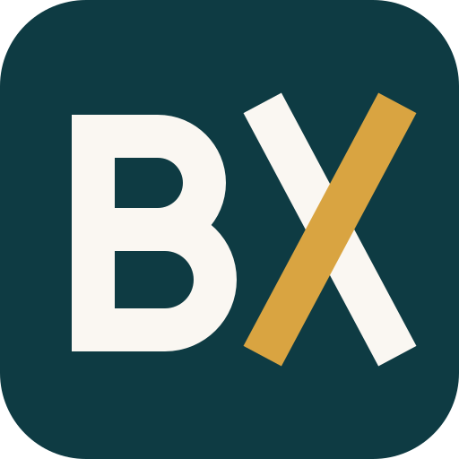
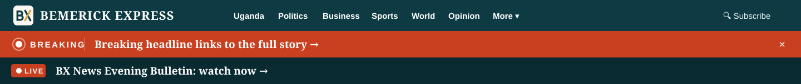
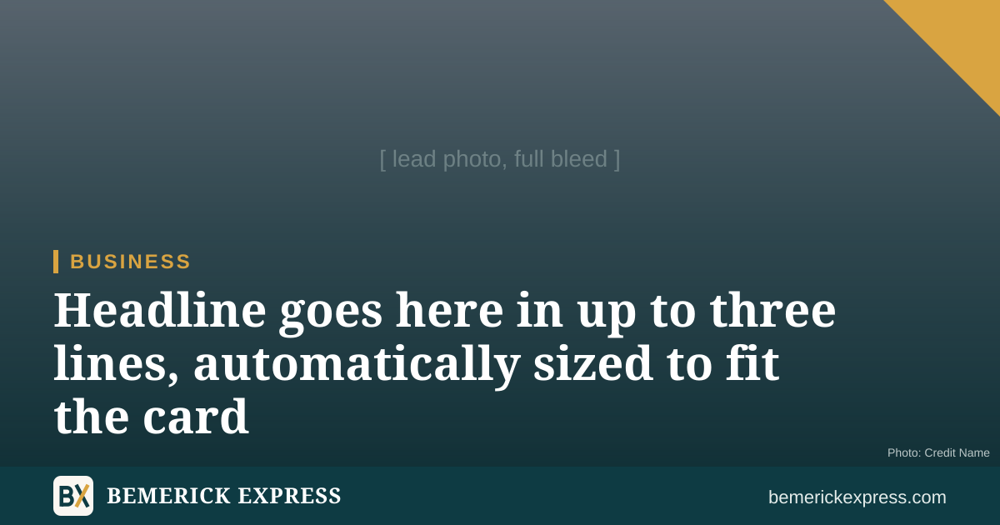
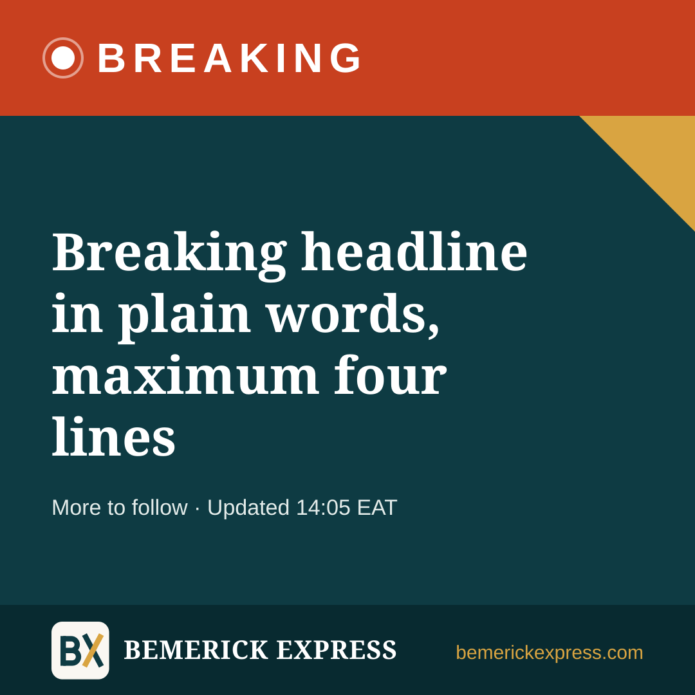

# Brand assets (draft v0.1)

All files are **drafts** (decision D-015). Full guidelines: [docs/01-brand-identity.md](../docs/01-brand-identity.md).

| Preview | File | Use |
|---------|------|-----|
|  | `logo-wordmark.svg` | Header on light backgrounds |
|  | `logo-wordmark-reverse.svg` | On Lake Ink / dark |
|  | `logo-mark-bx.svg` | Social avatars, app icon |
|  | `favicon.svg` | Browser tab |
|  | `breaking-banner-web.svg` | Header, breaking banner and live banner spec |
|  | `social-share-1200x630.svg` | Link preview (auto-generated per story) |
|  | `breaking-card-1080x1080.svg` | Breaking post: WhatsApp Channel, X |
|  | `social-story-1080x1920.svg` | WhatsApp Status, TikTok cover |

> **Note:** previews on GitHub use fallback fonts (Georgia/Arial) because SVG images can't load web fonts. Install [Newsreader](https://fonts.google.com/specimen/Newsreader) and [Instrument Sans](https://fonts.google.com/specimen/Instrument+Sans) locally to see them as designed. You can edit these files in Figma, Canva, Inkscape or a text editor.

## Before final use
- Convert wordmark text to outlines.
- Export PNGs: 512, 192, 180 (Apple touch), 32 and 16px.
- Create a 1-colour (all Lake Ink) and an all-white version.
