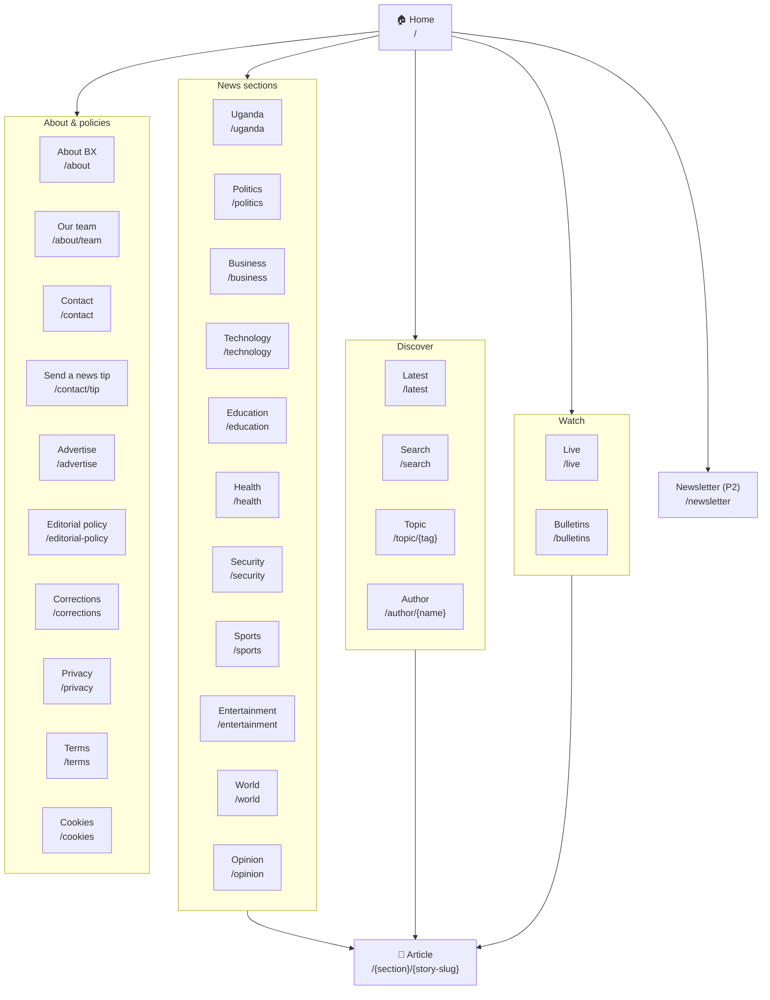
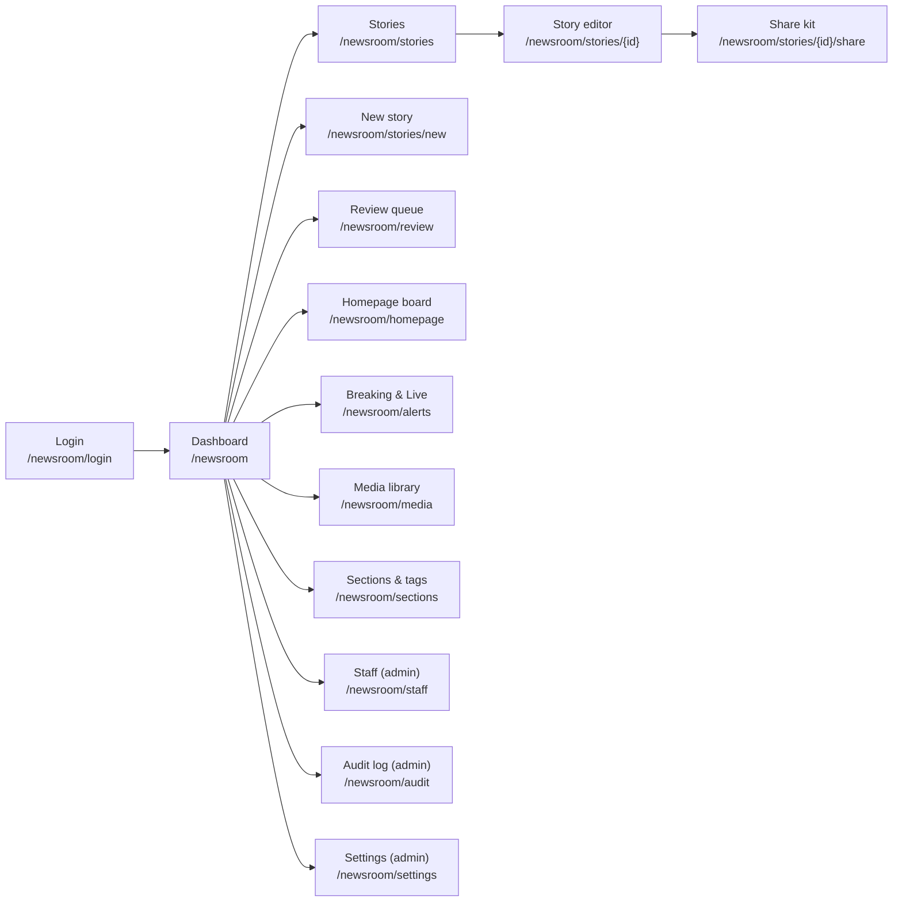
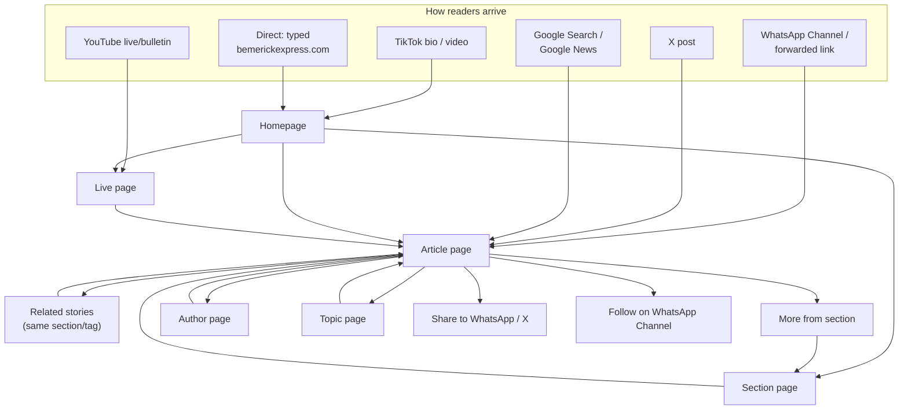
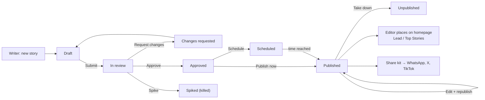

# 02 · Product Blueprint

> What BX News is, who it serves, what the site does, how readers move through it, what each page looks like, how it makes money, and how it stays within the rules.
> **Status:** v0.1 draft for discussion. Sections marked 💬 are ones we still need to talk through.

**Contents**
1. [Product summary](#1-product-summary)
2. [Audience](#2-audience)
3. [Content model](#3-content-model-what-we-publish)
4. [Features](#4-features)
5. [Sitemap](#5-sitemap)
6. [Navigation map](#6-navigation-map)
7. [URLs and the browser tab](#7-urls-and-the-browser-tab)
8. [Homepage curation](#8-homepage-curation-lead--top-stories)
9. [Page wireframes](#9-page-wireframes)
10. [Distribution channels](#10-distribution-channels-whatsapp-tiktok-x)
11. [Compliance-by-design](#11-compliance-by-design)
12. [How the site makes money](#12-how-the-site-makes-money)
13. [Success metrics](#13-success-metrics)

---

## 1. Product summary

| | |
|---|---|
| **What** | A professional, text-first digital news publication for Uganda |
| **Format** | Written stories led by photographs. Live streams and video bulletins are hosted on YouTube and embedded/linked |
| **Promise** | *Fast, verified, clear.* Breaking news quickly, then the context that explains it |
| **Platforms** | Mobile web first (most readers), desktop web, then WhatsApp Channel, TikTok and X for distribution |
| **Launch language** | English (Luganda and Swahili later) |
| **Not in scope at launch** | Video storage, reader comments, paywall/payments, mobile apps, AI-written stories |

---

## 2. Audience

### Primary readers

| Persona | Who | Context | What they need from BX |
|---------|-----|---------|------------------------|
| **"Commuter Brian"** | 22–35, Kampala/Wakiso, works or studies | Reads on a mid-range Android phone, often on mobile data, in short bursts (taxi, boda, lunch) | Fast-loading pages, headlines that tell the story, WhatsApp updates he can forward |
| **"Professional Sarah"** | 28–50, manager, civil servant, business owner | Phone in the morning, laptop at work | Reliable business, policy and Parliament coverage; a morning briefing; analysis |
| **"Upcountry Okello"** | 18–45, regional towns | Patchy 3G/4G, data-cost sensitive | Very light pages, district and regional news, later local languages |
| **"Diaspora Grace"** | Ugandans abroad (UK, US, Gulf, East Africa) | Desktop and phone, different time zones | Trustworthy news from home, live streams of big events |

### Design consequences
- **Mobile-first, data-light:** target under **500 KB** for an article page on first load, and images sized for the phone.
- **Headline clarity:** many readers will only see the headline in WhatsApp or X, so it must carry the facts.
- **Shareability is a core feature**, not an extra. Every story gets a branded share card automatically.
- **Times in EAT** (East Africa Time) with relative times ("12 min ago") for fresh stories.

---

## 3. Content model (what we publish)

| Type | Description | Label shown to readers |
|------|-------------|------------------------|
| **News** | Straight reporting of events | Section kicker only (e.g. `POLITICS`) |
| **Breaking** | Short, urgent news story, updated as facts arrive | `BREAKING` (Ember) while active |
| **Analysis** | Explains what news means | `ANALYSIS` |
| **Opinion** | A named writer's views | `OPINION` + writer photo |
| **Feature** | Longer human-interest or investigative story | `FEATURE` |
| **Bulletin** | A BX News video bulletin hosted on YouTube, with text summary | `BULLETIN` + ▶ |
| **Live** | A live stream page (YouTube Live) with running text updates *(text live-blog later)* | `LIVE` (Ember) |
| **Sponsored** | Paid content | `SPONSORED` / `PAID PARTNERSHIP`, always visible |
| **Photo story** | A gallery-led story | `IN PICTURES` |

### Sections (categories)
Editable by the admin. These are the launch set:

| Section | Sub-sections (optional) |
|---------|-------------------------|
| **Uganda** | National, Parliament, Districts / Regions, Kampala |
| **Politics** | |
| **Business** | Markets, Agriculture, Personal Finance |
| **Technology** | |
| **Education** | |
| **Health** | |
| **Security** | |
| **Sports** | Football, Athletics, Other Sports |
| **Entertainment** | |
| **World** | Africa, International |
| **Opinion** | Columns, Editorials, Letters |

**Tags** connect stories across sections (e.g. `Elections 2026`, `KCCA`, `Uganda Cranes`) and power topic pages.

---

## 4. Features

Priority: **P0** = needed for the first published story · **P1** = needed for public launch · **P2** = after launch

### 4.1 Reader-facing features

| Feature | Priority | Notes |
|---------|----------|-------|
| Homepage with editor-picked Lead + Top Stories | P0/P1 | P0 = latest list; P1 = full curation (see §8) |
| Article page with photo, byline, date, body, related stories | P0 | |
| Section pages | P1 | |
| Breaking-news banner (site-wide) | P1 | Auto-expiry, one at a time |
| Live page + site-wide LIVE indicator | P1 | YouTube Live embed (§9.6) |
| Bulletins page (YouTube) | P1 | |
| Author pages (photo, bio, role, stories) | P1 | Builds trust and Google credibility |
| Tag/topic pages | P1 | |
| Latest news page (reverse-chronological) | P1 | |
| Search | P1 | Postgres full-text search |
| "Updated" timestamp and corrections notice on articles | P1 | §11 |
| Share buttons: WhatsApp, X, copy link, native share | P1 | WhatsApp first |
| Auto-generated share image per story | P1 | Brand template, §01-brand §5 |
| Policy pages (About, Contact, Editorial, Corrections, Privacy, Terms, Cookies, Advertise) | P1 | Required for trust and AdSense |
| Newsletter sign-up (email, double opt-in) | P2 | Morning briefing |
| Web push notifications (opt-in) | P2 | Breaking only, standard Web Push |
| Text live blogs (minute-by-minute) | P2 | For elections, budget day, matches |
| Photo galleries | P2 | |
| Dark mode | P1 | Free with design tokens |
| Luganda and Swahili versions | P2+ | D-004 |
| Reader accounts, saved stories | P2+ | |
| Comments | Not planned | Moderation burden + legal risk. Revisit later |

### 4.2 Newsroom (staff) features

| Feature | Priority | Notes |
|---------|----------|-------|
| Staff login (no public sign-up) | P0 | |
| Story editor: headline, standfirst, body, lead photo, section, tags, type | P0 | Rich text editor |
| Publish / unpublish | P0 | |
| Review workflow: submit → review → approve / request changes / spike | P1 | Admin can self-approve while the team is one person |
| Scheduling | P1 | |
| Homepage curation board (Lead + Top Stories + section rows) | P1 | §8 |
| Breaking banner control | P1 | |
| Live stream control (paste YouTube link, set LIVE/ENDED) | P1 | |
| Media library (upload, credit, caption, alt text, licence) | P1 | Required fields enforced |
| Corrections tool (adds dated note to story) | P1 | |
| Share kit per story (ready WhatsApp/X/TikTok text + images) | P1 | §10 |
| Pre-publish checklist (sources, photo rights, legal flags) | P1 | §11 |
| Staff management (invite, role, disable) | P1 | Admin only |
| Audit log | P1 | Who did what, when |
| Section and tag management | P1 | |
| Simple dashboard (drafts, in review, published today, top stories today) | P1 | |
| Ad slot management (house/direct ads) | P2 | §12 |
| Translation management | P2+ | |

---

## 5. Sitemap

The full structure of the public website and the newsroom portal.



### 5.1 Complete page inventory

| Area | Page | URL | Indexed by Google? |
|------|------|-----|--------------------|
| Core | Home | `/` | ✅ |
| Core | Section (×11) | `/{section}` e.g. `/business` | ✅ |
| Core | Sub-section | `/{section}/{sub}` e.g. `/sports/football` | ✅ |
| Core | Article | `/{section}/{story-slug}` | ✅ |
| Core | Latest | `/latest` | ✅ |
| Watch | Live | `/live` | ✅ |
| Watch | Bulletins | `/bulletins` | ✅ |
| Discover | Topic | `/topic/{tag}` | ✅ |
| Discover | Author | `/author/{name}` | ✅ |
| Discover | Search | `/search?q=` | ❌ (noindex) |
| About | About, Team, Contact, Tip, Advertise | `/about`, `/about/team`, `/contact`, `/contact/tip`, `/advertise` | ✅ |
| Policy | Editorial policy, Corrections, Privacy, Terms, Cookies | `/editorial-policy`, `/corrections`, `/privacy`, `/terms`, `/cookies` | ✅ |
| Reader | Newsletter (P2) | `/newsletter` | ✅ |
| System | 404 / 500 | n/a | ❌ |
| Machine | XML sitemap, Google News sitemap, RSS, robots | `/sitemap.xml`, `/news-sitemap.xml`, `/rss.xml`, `/{section}/rss.xml`, `/robots.txt` | n/a |
| Future | Luganda / Swahili | `/lg/...`, `/sw/...` | ✅ |

### 5.2 Newsroom portal (staff only, never indexed)



The portal is at `/newsroom` (not `/admin`, which bots scan constantly). It is blocked in `robots.txt`, sends `noindex` headers, and every page checks login + role **on the server**.

---

## 6. Navigation map

### 6.1 Global navigation (every public page)

**Desktop header**
```
[BX] BEMERICK EXPRESS   Uganda  Politics  Business  Sports  World  Opinion  More ▾   ● LIVE   🔍  Subscribe
```
- `More ▾` opens: Technology, Education, Health, Security, Entertainment, Bulletins, Latest.
- `● LIVE` appears **only** when a stream is on air (Ember pill), otherwise hidden.
- The header shrinks to a slim sticky bar on scroll.

**Mobile header**
```
[BX] BEMERICK EXPRESS                  🔍  ☰
Uganda · Politics · Business · Sports · World · Opinion · Tech · …   ← horizontal swipe strip
```
- The **swipeable section strip** under the logo is the main mobile navigation (one thumb, no menu needed).
- `☰` opens a full-screen menu: all sections, Live, Bulletins, Latest, About, Contact, Advertise, and later Newsletter and language switch.

**Footer (every page)**
| Column 1: Sections | Column 2: Watch & discover | Column 3: About BX | Column 4: Follow |
|---|---|---|---|
| All 11 sections | Live, Bulletins, Latest, Topics | About, Team, Contact, Send a tip, Advertise | WhatsApp Channel, TikTok, X, YouTube, Facebook |
| | | Editorial policy, Corrections, Privacy, Terms, Cookies | © BEMERICK EXPRESS 2026 |

### 6.2 Reader journeys



**Key principle:** most readers will **land on an article page, not the homepage**, from a WhatsApp or X link. So the article page must:
1. load fast,
2. show the full BX header so they know where they are,
3. offer a strong **"next story"** (related stories plus "Latest" rail),
4. invite them to **follow the WhatsApp Channel**.

### 6.3 Newsroom journey (story lifecycle)



💬 **To discuss together:** section order in the main nav (what's most important for BX readers?), and whether `Uganda` should be the first item or split into `Kampala` + `Regions`.

---

## 7. URLs and the browser tab

### 7.1 What a reader actually sees

You asked for the browser to show **only the BEMERICK EXPRESS name and logo**. Here is what is possible:

| Place | What it shows | Can we control it? |
|-------|---------------|--------------------|
| **Browser tab** | **BX icon** + `Headline · BEMERICK EXPRESS` | ✅ Fully. This is our favicon + page title |
| **Phone home-screen shortcut / installed web app** | BX icon + "BX News"; opens with **no address bar at all** | ✅ Via the web app manifest (P1) |
| **Link previews** (WhatsApp, X) | BX share card + headline + `bemerickexpress.com` | ✅ |
| **Address bar** | The web address, e.g. `bemerickexpress.com/business/fuel-prices-drop` | ⚠️ **Cannot be hidden.** Every browser shows it for security reasons (to stop fake sites), and Google needs a distinct address per story to index it. Chrome on Android and Safari on iPhone already shorten it to just the domain until tapped |

**So the plan is:** make the address so short and clean that it *reads like the brand*. Modern mobile browsers show only `bemerickexpress.com` most of the time anyway. Internal details (database IDs, `.php`, `?id=123`, language codes for English, dates) **never appear**, and they stay in the background as you asked.

### 7.2 URL rules
- Domain: **`bemerickexpress.com`** recommended (Q-001). Redirect `www.` to the bare domain.
- Article: `/{section}/{story-slug}` → `bemerickexpress.com/business/fuel-prices-drop-for-second-month`
- Slugs: lowercase, hyphens, no stop-word clutter, under 70 characters, written by the editor (auto-suggested from the headline).
- English has **no** language prefix. Future languages: `/lg/...` and `/sw/...`.
- If a headline, slug or section changes after publishing, the old URL **permanently redirects (301)** to the new one, so shared WhatsApp links never break.
- Short share links (P2, optional): `bemerickexpress.com/s/4kd9` for SMS and print.

---

## 8. Homepage curation (Lead & Top Stories)

Editors control the front page from a **Homepage board** in the newsroom (D-009).

### 8.1 Homepage slots

| Zone | Slots | Who fills it | Fallback if empty/expired |
|------|-------|--------------|---------------------------|
| **Breaking banner** | 1 | Editor/Admin | Hidden |
| **Live strip** | 1 | Editor/Admin | Hidden |
| **Lead story** | 1 | Editor picks | Most recent story marked "important" |
| **Top Stories row** | 4 | Editor picks and orders | Latest published stories not already shown |
| **Latest rail** | 10 | Automatic | n/a |
| **Section rows** | 1 per section (5 stories) | Automatic; editor can pin 1 | Latest in section |
| **Bulletins row** | 4 | Automatic | Hidden if none |
| **Opinion row** | 4 | Automatic; editor can pin | Latest opinion |
| **Most read** | 5 | Automatic (last 24h) | Hidden until enough data |

### 8.2 Board behaviour
- Drag and drop stories into **Lead** and **Top Stories 1–4**.
- Each slot can have an optional **"pin until"** time. After it, the slot falls back automatically, so the front page is never stale overnight.
- **Override headline and image for the homepage only** (e.g. a shorter headline for the lead), without changing the article.
- **Preview** the homepage before saving. Every change is recorded in the audit log.
- A story is never shown twice on the same homepage (the system removes duplicates).

---

## 9. Page wireframes

Low-fidelity layouts to agree structure before visual design. Ad slots are marked `[AD]` and **reserve their space** even when empty (so the page never jumps).

### 9.1 Homepage: mobile (primary)
```
┌─────────────────────────────┐
│ [BX] BEMERICK EXPRESS  🔍 ☰ │  ← sticky header (Lake Ink)
│ Uganda·Politics·Business·…→ │  ← swipe strip
├─────────────────────────────┤
│● BREAKING  Headline text… × │  ← Ember, only when active
├─────────────────────────────┤
│ ┌─────────────────────────┐ │
│ │      LEAD PHOTO 16:9    │ │
│ └─────────────────────────┘ │
│ UGANDA                      │  ← gold kicker
│ Lead headline in large      │
│ serif across two lines      │
│ Standfirst one sentence…    │
│ 25 min ago                  │
├─────────────────────────────┤
│ TOP STORIES                 │
│ [img] Headline 1      ……    │
│ [img] Headline 2      ……    │
│ [img] Headline 3      ……    │
│ [img] Headline 4      ……    │
├─────────────────────────────┤
│ ● LIVE  Evening bulletin ▶  │  ← only when live
├─────────────────────────────┤
│ [AD  300×250]               │
├─────────────────────────────┤
│ LATEST                      │
│ 14:05  Headline…            │
│ 13:40  Headline…            │
│ …  See all latest →         │
├─────────────────────────────┤
│ POLITICS ─────────── More → │
│ [img] Headline (big)        │
│ Headline · Headline · …     │
├─────────────────────────────┤
│ BUSINESS / SPORTS / …       │  ← repeating section rows
├─────────────────────────────┤
│ BULLETINS ▶  (scroll row)   │
│ OPINION  (writer photos)    │
├─────────────────────────────┤
│ 📲 Follow BX on WhatsApp    │  ← channel CTA
├─────────────────────────────┤
│ FOOTER                      │
└─────────────────────────────┘
```

### 9.2 Homepage: desktop
```
┌────────────────────────────────────────────────────────────────────┐
│ [BX] BEMERICK EXPRESS  Uganda Politics Business Sports World Opinion More▾ ●LIVE 🔍 Subscribe │
├────────────────────────────────────────────────────────────────────┤
│ ● BREAKING  Headline text links to story…                        × │
├────────────────────────────────────────────────────────────────────┤
│ [AD 970×90 leaderboard, optional]                                  │
├──────────────────────────────────────────────┬─────────────────────┤
│ ┌──────────────────────────────────────────┐ │ LATEST              │
│ │            LEAD PHOTO 16:9               │ │ 14:05 Headline…     │
│ └──────────────────────────────────────────┘ │ 13:40 Headline…     │
│ UGANDA                                       │ 13:12 Headline…     │
│ Lead headline, large serif                   │ …                   │
│ Standfirst…            By Name · 25 min ago  │ See all →           │
├──────────┬──────────┬──────────┬─────────────┤─────────────────────┤
│ [img]    │ [img]    │ [img]    │ [img]       │ [AD 300×250]        │
│ Top 1    │ Top 2    │ Top 3    │ Top 4       │                     │
├──────────┴──────────┴──────────┴─────────────┴─────────────────────┤
│ ● LIVE NOW ▶  [YouTube thumbnail]  Title · Watch →                 │
├────────────────────────────────────────────────────────────────────┤
│ POLITICS ───────────────────────────────────────────── More →      │
│ [big img + headline]   │ headline │ headline │ headline            │
├────────────────────────────────────────────────────────────────────┤
│ BUSINESS · SPORTS · WORLD … (repeat)       │ MOST READ 1–5         │
├────────────────────────────────────────────────────────────────────┤
│ BULLETINS ▶ ▶ ▶ ▶        │  OPINION  (photo) (photo) (photo)       │
├────────────────────────────────────────────────────────────────────┤
│ FOOTER: Sections | Watch | About BX | Follow                       │
└────────────────────────────────────────────────────────────────────┘
```

### 9.3 Article page (mobile; desktop adds a right rail)
```
┌─────────────────────────────┐
│ header + swipe strip        │
├─────────────────────────────┤
│ Home › Business › Markets   │  ← breadcrumb
│ BUSINESS · ANALYSIS         │  ← kicker + type label
│ Article headline in large   │
│ serif, up to three lines    │
│ Standfirst in italic serif… │
│ [photo] By Jane Namuli      │  ← links to author page
│ 15 Nov 2026, 14:05 EAT      │
│ Updated 16:30 EAT           │  ← only if updated
│ [WhatsApp] [X] [Copy] [⇪]   │
├─────────────────────────────┤
│ ┌─────────────────────────┐ │
│ │     LEAD PHOTO 16:9     │ │
│ └─────────────────────────┘ │
│ Caption. Photo: Credit      │
├─────────────────────────────┤
│ Body paragraph…             │
│ Body paragraph…             │
│ [AD in-article, after ¶3]   │
│ Body paragraph… [inline img]│
│ "Pull quote"                │
│ Body…                       │
├─────────────────────────────┤
│ ⓘ Correction 16 Nov: An     │  ← only if corrected
│   earlier version said…     │
├─────────────────────────────┤
│ Topics: [KCCA] [Budget]     │
│ [WhatsApp] [X] [Copy]       │
│ 📲 Get BX on WhatsApp       │
├─────────────────────────────┤
│ RELATED STORIES (3–4)       │
│ MORE IN BUSINESS            │
│ LATEST (5)                  │
└─────────────────────────────┘
```
Desktop: body max 680px; right rail with Latest, Most read and `[AD 300×600]` (sticky).

### 9.4 Section page
```
┌─────────────────────────────┐
│ header                      │
│ BUSINESS                    │  ← section title + short description
│ Markets · Agriculture · …   │  ← sub-section chips
├─────────────────────────────┤
│ [Section lead: big image]   │  ← editor can pin, else latest
├─────────────────────────────┤
│ [img] Headline · time       │
│ [img] Headline · time       │
│ [AD]                        │  ← after 6 stories
│ … Load more (button)        │  ← no infinite scroll (data-friendly)
└─────────────────────────────┘
```

### 9.5 Author page
```
│ [photo] Jane Namuli                     │
│ Business Reporter · Kampala             │
│ Short bio. Follow on X →                │
│ ─────────────────────────               │
│ Stories by Jane (list, paginated)       │
```

### 9.6 Live page (YouTube)
```
┌─────────────────────────────┐
│ header                      │
│ ● LIVE  BX News Evening     │
│ Bulletin, 15 Nov            │
│ ┌─────────────────────────┐ │
│ │  YouTube player (16:9)  │ │  ← click-to-load facade: no YouTube
│ │      ▶ Tap to watch     │ │     data used until reader taps
│ └─────────────────────────┘ │
│ Summary / what's on now     │
│ Key points (editor updates) │
│ Related stories             │
│ Watch on YouTube ↗          │
├─────────────────────────────┤
│ When nothing is live:       │
│ "Next live: Mon 7:00 PM"    │
│ Latest bulletins grid       │
└─────────────────────────────┘
```

### 9.7 Newsroom: story editor
```
┌──────────────────────────────────────────────┬───────────────────────┐
│ ← Stories     Status: DRAFT       [Save] [Submit for review ▸]       │
├──────────────────────────────────────────────┼───────────────────────┤
│ Headline ______________________________ 72/110│ Section   [Business ▾]│
│ Standfirst ____________________________       │ Sub       [Markets ▾] │
│ ┌──────────────────────────────────────────┐ │ Type      [News ▾]    │
│ │ Rich text body (B I H2 quote link img)    │ │ Tags      [+ add]     │
│ │                                           │ │ Priority  ○Normal     │
│ │                                           │ │           ○Important  │
│ │                                           │ │           ○Breaking   │
│ └──────────────────────────────────────────┘ │ Lead photo [Choose]   │
│                                              │  credit ✔ alt ✔       │
│ SEO title / description (auto, editable)     │ URL slug  [auto…]     │
│ Social headline (for share card)             │ Byline    [Jane ▾]    │
│                                              │ Schedule  [date/time] │
│                                              │ ─────────────────     │
│                                              │ Pre-publish checklist │
│                                              │ ☐ Sources verified    │
│                                              │ ☐ Photo rights OK     │
│                                              │ ☐ Legal flags checked │
│                                              │ Revision history →    │
└──────────────────────────────────────────────┴───────────────────────┘
```

### 9.8 Newsroom: homepage board
```
┌─────────────────────────────────────────────────────────────────────┐
│ Homepage board                         [Preview] [Save changes]      │
├───────────────────────────────┬─────────────────────────────────────┤
│ LEAD                          │ Recently published (drag from here)  │
│ ┌───────────────────────────┐ │ ○ Fuel prices drop…     Business 14:05│
│ │ Story title  pin until ⏱  │ │ ○ Cranes squad named…   Sports   13:40│
│ │ [override headline/image] │ │ ○ …                                   │
│ └───────────────────────────┘ │ 🔍 search all published               │
│ TOP STORIES                   │                                       │
│ 1 [story] ⏱  2 [story] ⏱      │                                       │
│ 3 [empty → auto]  4 [story]   │                                       │
├───────────────────────────────┴─────────────────────────────────────┤
│ BREAKING: [text] [link story] expires [3h ▾] [Activate] [Clear]      │
│ LIVE:     [YouTube URL] [title] status [Scheduled|LIVE|Ended]        │
└─────────────────────────────────────────────────────────────────────┘
```

💬 **To discuss together:** go through these wireframes page by page. Once agreed, they become high-fidelity mock-ups in the brand colours.

---

## 10. Distribution channels (WhatsApp, TikTok, X)

In Uganda, many people meet the news in **WhatsApp first**. The website is the **home of the full story**, and the channels bring readers to it.

| Channel | Role | Content | Frequency (start) | Link back to site |
|---------|------|---------|-------------------|-------------------|
| **WhatsApp Channel** (priority 1) | Main "push" to readers. Free, and reaches people without the app being opened by us | Breaking alerts (breaking card), **Morning Briefing** (5 headlines at 7:00 EAT), evening wrap | 3–6 posts/day | Every post has the story link |
| **TikTok** (priority 2) | Reach young audiences with the **BX anchor format** | 30–90s vertical explainers: an anchor presents a top story; "3 things to know today"; live clips | 1–2/day | Link in bio; "full story on bemerickexpress.com" |
| **X** (priority 3) | Breaking, live coverage, journalists and officials | Breaking posts, threads during live events, every published story | Every story + live threads | Every post |
| YouTube | Hosts live streams and bulletins (D-003) | Bulletins, live events, TikTok re-cuts as Shorts | As produced | Description links |
| Facebook | Reserve the handle; secondary (very large Ugandan audience 25+) | Auto-share of top stories | Later | |

### Newsroom "Share kit" (built into each story)
For every published story the system prepares:
- **WhatsApp text:** emoji kicker + headline + one-line summary + link (WhatsApp formatting with `*bold*`).
- **X text:** headline + link + 1–2 hashtags, within the character limit.
- **TikTok script prompt:** headline, 3 key facts, sign-off line ("Full story at bemerickexpress.com").
- **Images:** 1200×630 link card, 1080×1080 (breaking), 1080×1920 (Status/TikTok cover), auto-generated from the brand templates.
- **One-tap copy buttons.**

**Automation:** WhatsApp Channels don't currently offer a public posting API, so start with **manual posting using the share kit**. That takes under 30 seconds per story. X auto-posting can be added later if the API cost is justified.

---

## 11. Compliance-by-design

Registration with regulators is deferred (D-013), but the product is built so that **normal use does not break the rules**. This is a design checklist, not legal advice. Have a Ugandan media lawyer review the policy pages before launch.

### 11.1 Personal data (Uganda Data Protection and Privacy Act, 2019, and good practice)
- **Collect the minimum.** At launch, readers give us **no personal data**. No accounts, no comments. Newsletter (P2) collects only email + preferences.
- **Consent:** double opt-in for email; push only after the reader taps "Allow"; one-click unsubscribe.
- **Cookieless analytics first:** Cloudflare Web Analytics (no cookies, no personal data), so no consent banner is needed at launch. Google Analytics/AdSense are added later with a **consent banner** before any non-essential cookie is set.
- **Privacy notice** explains what is collected, why, how long, and how to ask for access, correction or deletion.
- **Security:** staff accounts use strong passwords plus 2-factor authentication (P1); all data encrypted in transit (HTTPS); databases not publicly reachable; least-privilege roles.
- **Tip line:** the `/contact/tip` form stores the minimum and states clearly how sources are protected; tips are only visible to editors.
- Registration with the **Personal Data Protection Office** before collecting subscriber data (track as a launch task).

### 11.2 Editorial & legal safety (built into the workflow)
- **Pre-publish checklist** (in the editor): sources verified · right of reply sought where someone is accused · photo rights confirmed · no identification of children in sensitive stories or of victims of sexual offences · court-reporting restrictions checked.
- **Legal flag:** a writer or editor can mark a story "Legal review needed". It cannot be published until an admin clears the flag.
- **Corrections policy + visible corrections** on the story and a public `/corrections` log.
- **Opinion and sponsored labelled**, with no exceptions. Sponsored content is never created by the news desk.
- **Photo credit and licence fields are mandatory.** No publishing with a missing credit.
- **Revision history** keeps every published version (proof of what was said and when).
- **Takedown process:** "Unpublished" status, with reason recorded in the audit log.

### 11.3 Platform policies
- **Google AdSense / Google News:** original content, clear About/Contact/policies, author pages, no misleading headlines.
- **YouTube:** embeds use privacy-enhanced mode (`youtube-nocookie.com`) and load only when the reader taps.
- **WhatsApp/TikTok/X:** follow each platform's news and political content rules; no paid political promotion without clear labels.

### 11.4 Accessibility
WCAG 2.2 AA: colour contrast (checked in brand doc), alt text required on images, keyboard navigation, captions on bulletins (YouTube auto-captions reviewed), readable font sizes, reduced-motion support.

---

## 12. How the site makes money

Revenue is **phased**: build audience trust first, then monetise without hurting the reading experience. Payments are deferred (D-012).

| Phase | When | Stream | How | Notes |
|-------|------|--------|-----|-------|
| 0 | Launch | **None (build audience)** | Ad slots are designed in and reserved, showing BX house promos (WhatsApp Channel, TikTok) | Proves the layout works with ads |
| 1 | ~1–3 months after launch | **Google AdSense** | Apply once there are ~30+ quality original stories, all policy pages and steady traffic | Approval not guaranteed. Requires consent banner |
| 1 | Same time | **Direct display ads** | Sell homepage leaderboard, in-article and sidebar slots to Ugandan businesses (rate card on `/advertise`) | Higher value than AdSense per view. Invoiced manually at first |
| 2 | After 5–10k WhatsApp followers | **Sponsored content** | Clearly labelled paid partnerships, written by a separate (non-news) contributor | Strict labelling (§11.2) |
| 2 | | **WhatsApp/TikTok sponsorships** | "Morning Briefing brought to you by…" | Labelled |
| 2 | | **Newsletter sponsorship** | Once the newsletter exists | |
| 3 | Later | **Live event and bulletin sponsorship** | Election night, budget day, sports coverage | |
| 3 | Later | **Memberships / donations** | Mobile money via an aggregator (MTN MoMo, Airtel Money) | Payments phase |
| 3 | Later | **Content licensing / syndication** | License stories/photos to other outlets | |

### Ad experience rules
- Max **3 ad slots** on an article page on mobile (no pop-ups, no auto-playing video ads, no ads above the headline).
- Every ad slot has a **fixed reserved size**, so no layout jumping.
- Ads are visually separated and labelled "Advertisement".
- Ads never appear inside breaking banners, live players or opinion bylines.

---

## 13. Success metrics

| Metric | 3 months after launch | 6 months | 12 months |
|--------|-----------------------|----------|-----------|
| Stories published per week | 25+ | 50+ | 100+ |
| Monthly unique visitors | 10k | 50k | 200k |
| WhatsApp Channel followers | 2k | 10k | 50k |
| TikTok followers | 1k | 10k | 50k |
| Article page load (mobile, 4G) | < 2.5 s | < 2 s | < 2 s |
| Corrections issued within 24h of error being raised | 100% | 100% | 100% |
| Revenue | n/a | First direct ad | Covers hosting + part-time staff |

*Targets are starting assumptions. Revisit at each quarterly review.*
