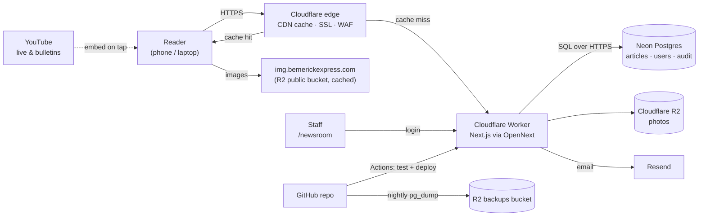
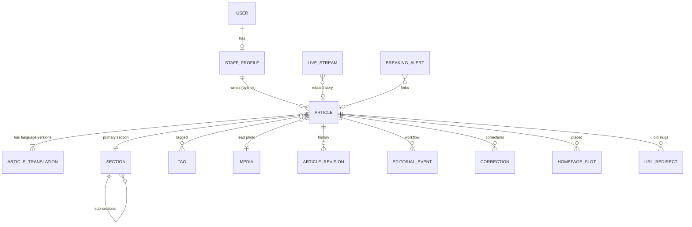

# 03 · Technical Architecture & Hosting

> **Goal:** a professional, fast, secure news platform that runs at **$0/month** at the start, on **PostgreSQL**, **without Supabase**, with a clear paid upgrade path when traffic grows.
> **Status:** v0.1 proposed (D-005 to D-008, D-017, D-018). Free-tier limits change, so **verify every limit on the provider's pricing page before relying on it**.

---

## 1. The stack at a glance

| Layer | Choice | Cost at start | Why |
|-------|--------|---------------|-----|
| Web framework | **Next.js** (App Router) + **TypeScript** | Free | One codebase for public site + newsroom; huge ecosystem |
| Styling | **Tailwind CSS** + brand tokens (+ shadcn/ui for the newsroom) | Free | Fast, consistent, small CSS output |
| Hosting / CDN | **Cloudflare Workers** via the **OpenNext** adapter | Free plan | Global CDN incl. Africa edge locations, free SSL, DDoS protection, commercial use allowed |
| Database | **Neon Serverless PostgreSQL** | Free plan | Real Postgres (D-005), branching for dev/prod, works over HTTP from Workers |
| Database toolkit | **Drizzle ORM** + drizzle-kit migrations | Free | Type-safe queries, SQL migrations stored in Git |
| Authentication | **Better Auth** (open source, runs inside our app) | Free | Stores users in **our** Postgres; email+password, 2FA, admin/roles plugin; no vendor lock-in |
| Images / files | **Cloudflare R2** object storage | Free tier (~10 GB) | **No egress fees**, which is critical for an image-heavy news site |
| Rich text editor | **Tiptap** (stores JSON) | Free (open-source core) | Clean structured article bodies |
| Video / live | **YouTube** embeds (privacy-enhanced, click-to-load) | Free | D-003. No video storage |
| Search | **PostgreSQL full-text search** | Included | No extra service |
| Transactional email | **Resend** (or Brevo) free tier | Free (low volume) | Staff invites, password resets; later newsletter confirmation |
| Incoming email | **Cloudflare Email Routing** | Free | `news@`, `tips@`, `ads@bemerickexpress.com` forward to existing inboxes |
| Analytics | **Cloudflare Web Analytics** (cookieless) → GA4 later with consent | Free | No consent banner needed at launch |
| Search visibility | Google Search Console, Bing Webmaster, Google News Publisher Center | Free | |
| Error monitoring | **Sentry** free tier | Free | Know when something breaks |
| Uptime | UptimeRobot / Better Stack free tier | Free | Alert if the site goes down |
| Code & CI | **GitHub** (this repo) + GitHub Actions | Free | Automatic checks and deploys; nightly DB backup job |
| Domain | `bemerickexpress.com` via **Cloudflare Registrar** | **~US$10–15 / year** | Sold at wholesale cost with no markup; the only unavoidable cost |

**Total: US$0/month + about US$10–15/year for the domain.**
Until the domain is bought, the site runs on a free `*.workers.dev` address.

### About the domain
- **Recommended:** `bemerickexpress.com`. It's global, trusted and matches the masthead.
- **Optional later:** `bemerickexpress.co.ug` / `bxnews.co.ug` (from a Ugandan registrar, usually more expensive per year) redirecting to the `.com`. This protects the brand locally.
- Check availability in the Cloudflare dashboard → *Domain Registration*. Buy it **before** announcing the name publicly.
- Free domains (e.g. `.tk`-style) are **not** suitable for a professional publication: they are often blocked, flagged as spam, or reclaimed.

---

## 2. Why not Supabase, and what replaces it

Supabase bundles database + auth + storage. Its free plan **pauses projects after about a week of inactivity** and has no backups, which is risky for a public news site. We replace each part with a free, focused tool:

| Supabase piece | Replacement | Trade-off |
|----------------|-------------|-----------|
| Postgres database | **Neon** | Free compute scales to zero when idle and **wakes automatically** in about a second (no manual "un-pause"). Mitigated by caching (§4) so most readers never touch the database |
| Auth | **Better Auth** | We run it ourselves, so there's slightly more setup. In return we have full control and users stored in our own Postgres |
| Storage | **Cloudflare R2** | Same provider as hosting, no egress fees |
| Row Level Security | **Server-only data access + role checks in code**, plus a restricted DB role | The browser **never** talks to the database directly. Every read and write goes through our server code, which checks the user's role (§8) |

**If Neon ever becomes unsuitable**, the same Postgres schema moves to any Postgres host (e.g. a $5 VPS, Railway, Aiven, or even Supabase as plain Postgres) with `pg_dump`/`pg_restore`. **No lock-in.**

---

## 3. Hosting on Cloudflare and the week-1 spike

### 3.1 Architecture

### 3.2 The concern, and how we resolve it
Next.js runs on Cloudflare Workers using the **OpenNext Cloudflare adapter** (`@opennextjs/cloudflare`). Two Workers **free-plan** limits matter:

1. **Worker bundle size:** the free plan allows a smaller compressed script size than paid. Large Next.js apps can exceed it.
2. **CPU time per request:** the free plan allows very little CPU time per request. Server-rendering a page on every request can exceed it.

**Mitigations designed in:**
- **Cache almost everything.** News pages are the same for every reader, so pages are rendered once and served from cache (Incremental Static Regeneration). When an editor publishes, only the affected pages (article, home, section) are refreshed, so readers almost never trigger rendering.
- Keep the public site lean: Server Components, minimal client JavaScript, no heavy libraries on public pages.
- Newsroom traffic is tiny (a few staff), so its rendering cost is negligible.

**Week-1 spike (Phase 0, decision D-008):** deploy a skeleton with a home page, an article page reading from Neon, and a login page to the free plan, then measure:

| Check | Pass | If it fails |
|-------|------|-------------|
| Bundle deploys on free plan | ✅ deploys | Trim dependencies. Otherwise go to **Plan B** |
| Article page renders without CPU-limit errors | ✅ no errors under a load test | Increase caching. Otherwise go to Plan B |
| Cached page load from Kampala (4G) | < 1.5 s | Investigate |

**Plan B (only if the spike fails):** either (a) **Cloudflare Workers Paid** at about **US$5/month**, which gives higher limits; this is the simplest fix and the first paid upgrade anyway, or (b) rebuild the public site in **Astro** (lighter output, first-class Cloudflare support) while keeping the same database and design. The decision gets recorded in the Decisions Log.

---

## 4. Performance budget (Ugandan mobile networks)

| Budget | Target |
|--------|--------|
| Article page total transfer (first visit) | **< 500 KB** including lead image |
| JavaScript on public pages | **< 100 KB** compressed |
| Largest Contentful Paint (4G mid-range Android) | **< 2.5 s** |
| Layout shift (CLS) | **< 0.1** (all ad and image slots have reserved sizes) |
| Fonts | 2 families, ≤ 5 files, self-hosted, `font-display: swap` |

**Image pipeline ($0):** photos are resized **in the newsroom browser at upload time** into WebP at 480, 960 and 1600px widths. All three are stored in R2 and served via `img.bemerickexpress.com` through Cloudflare's cache. The page then uses `srcset` so a phone downloads the 480/960 version, not the original 5 MB camera file.

---

## 5. Data model (PostgreSQL)

UUID primary keys · all times stored in **UTC** (`timestamptz`) and displayed in **EAT** · `created_at` / `updated_at` everywhere · soft deletes where history matters.

### 5.1 Entity overview

### 5.2 Tables

**Auth (managed by Better Auth):** `user`, `session`, `account`, `verification`. Better Auth's admin plugin adds `role`, `banned` fields on `user`.

| Table | Key fields | Purpose |
|-------|-----------|---------|
| `staff_profile` | user_id, display_name, slug, job_title, bio, photo_media_id, x_handle, is_public, is_active | Public author pages + internal profile |
| `section` | id, parent_id, slug, name, description, sort_order, is_active, show_in_nav | Editable sections & sub-sections |
| `tag` | id, slug, name | Topics |
| `article` | id, type (`news`/`analysis`/`opinion`/`feature`/`bulletin`/`photo_story`/`sponsored`), status, priority (`normal`/`important`/`breaking`), primary_section_id, lead_media_id, youtube_video_id (bulletins), legal_hold, created_by, published_at, first_published_at, updated_public_at, scheduled_at | Language-independent core |
| `article_translation` | article_id, lang (`en`/`lg`/`sw`), headline, standfirst, body (JSONB, Tiptap), slug, seo_title, seo_description, social_headline, status, search_vector | Language versions (English only at launch). **Unique (lang, slug)** |
| `article_author` | article_id, staff_id, position | Bylines (supports co-authors) |
| `article_tag` | article_id, tag_id | |
| `media` | id, r2_key, variants (JSONB: 480/960/1600), width, height, mime, bytes, caption, alt_text, **credit** (required), licence, uploaded_by | Photo library |
| `article_revision` | article_id, lang, snapshot (JSONB), created_by, created_at | Full version history |
| `editorial_event` | article_id, from_status, to_status, actor_id, note, created_at | Workflow trail (submissions, approvals, spikes) |
| `correction` | article_id, text, published_at, created_by | Public corrections |
| `homepage_slot` | zone (`lead`/`top`/`section_pin`), position, article_id, override_headline, override_media_id, pinned_until, updated_by | Editor curation (D-009) |
| `breaking_alert` | text, article_id, starts_at, expires_at, is_active, created_by | Site-wide banner |
| `live_stream` | title, youtube_video_id, status (`scheduled`/`live`/`ended`), scheduled_start, summary, key_points (JSONB), related_article_id | Live page + LIVE pill |
| `url_redirect` | from_path, to_path, created_at | Old slugs → 301 |
| `audit_log` | actor_id, action, entity, entity_id, details (JSONB), ip_hash, created_at | Security trail (append-only) |
| `site_setting` | key, value (JSONB) | Social links, next live time, etc. |
| **P2:** `ad_slot`, `ad_campaign`, `ad_creative` | | Direct advertising |
| **P2:** `email_subscriber`, `push_subscription`, `notification_log` | | Engagement |

### 5.3 Search
`article_translation.search_vector` is a generated `tsvector` (headline weighted A, standfirst B, body text C) with a GIN index. Use the `english` configuration for English and `simple` for Luganda (no stemmer exists for it).

---

## 6. Article lifecycle (statuses)

Revised from v0 (D-018). `submitted` and `in_review` were merged. `rejected` is now **spiked** (newsroom term) or **changes requested**. **Unpublished** has been added for takedowns.

| Status | Meaning | Visible to public? |
|--------|---------|--------------------|
| `draft` | Being written | ❌ |
| `in_review` | Submitted; waiting for/with an editor | ❌ |
| `changes_requested` | Editor sent it back with notes | ❌ |
| `approved` | Cleared to publish | ❌ |
| `scheduled` | Will publish automatically at `scheduled_at` | ❌ until time |
| `published` | Live | ✅ |
| `unpublished` | Taken down after publishing (reason logged) | ❌ (URL returns 410 "removed") |
| `spiked` | Killed before publishing | ❌ |

**Allowed transitions** (enforced on the server, never just in the UI):

| From → To | Who |
|-----------|-----|
| draft → in_review | Writer (own), Editor, Admin |
| in_review → changes_requested / approved / spiked | Editor, Admin |
| changes_requested → draft (auto) → in_review | Writer (own) |
| approved → published / scheduled | Editor, Admin |
| draft → published (**fast-track**) | **Admin only**, logged in audit (one-person newsroom & genuine breaking news) |
| published → published (update) | Editor, Admin; Writer can propose an update that goes to review |
| published → unpublished | Admin (Editor with reason, logged) |
| any with `legal_hold = true` → published | ❌ Blocked until Admin clears the hold |

**Scheduling:** a Cloudflare **Cron Trigger** (free) runs every minute, publishes due stories in a transaction (idempotent: re-running never double-publishes), and refreshes the cache for affected pages.

---

## 7. Roles & permissions

Launch with **Admin** (D-010). **Editor** and **Writer** exist from day one so staff can be added any time. Permissions are stored as a map in code (Better Auth access control), so new roles don't need database changes.

| Permission | Admin | Editor | Writer | Later: Contributor | Later: Marketing |
|------------|:-----:|:------:|:------:|:------:|:------:|
| Create/edit own drafts | ✅ | ✅ | ✅ | ✅ | |
| Edit others' stories | ✅ | ✅ | | | |
| Approve / request changes / spike | ✅ | ✅ | | | |
| Publish / schedule | ✅ | ✅ | | | |
| Fast-track publish (skip review) | ✅ | | | | |
| Unpublish | ✅ | with reason | | | |
| Homepage board, breaking, live | ✅ | ✅ | | | |
| Media upload | ✅ | ✅ | ✅ | ✅ | ✅ |
| Sections & tags | ✅ | ✅ | | | |
| Corrections | ✅ | ✅ | | | |
| Ads & sponsored | ✅ | | | | ✅ |
| Staff & roles | ✅ | | | | |
| Settings, audit log | ✅ | view | | | |

- **No public sign-up.** The first Admin is created by a one-time setup script; everyone else is **invited** by an Admin.
- Nobody can change their own role.
- 2-factor authentication **required** for Admin and Editor (P1).

---

## 8. Security

| Area | Rule |
|------|------|
| Data access | Browser never connects to the database. All queries run on the server. Public queries **always** filter `status = 'published'` (one shared helper; drafts can't leak by accident) |
| Authorization | Every server action calls `requireRole(...)` / `can(user, permission)`, server-side |
| Secrets | In Cloudflare Worker secrets and `.env.local` (git-ignored). Separate dev and prod values. Nothing secret uses a `NEXT_PUBLIC_` prefix |
| Database | Separate Neon branches: `dev` and `main` (prod). The app connects with a role that cannot drop tables; migrations use a separate owner role |
| Uploads | Only JPEG/PNG/WebP, max 10 MB, re-encoded to WebP (strips location/EXIF data that could expose sources), random file names |
| Web | HTTPS only (HSTS), Content-Security-Policy, rate-limit login (Cloudflare WAF free rules), CSRF protection (built into Better Auth / server actions) |
| Audit | Login, publish, unpublish, role change, homepage change, breaking alert are all written to `audit_log` |
| Backups | Neon's built-in restore window **plus** a nightly `pg_dump` via GitHub Actions to a private R2 bucket (keep 30 days). **Test a restore monthly** |
| Bots | `/newsroom` blocked in robots and returns `noindex`; Cloudflare Bot Fight Mode on |

---

## 9. SEO & discovery (built in, not bolted on)

- Per-page `<title>` = `Headline · BEMERICK EXPRESS`, meta description = standfirst.
- **Open Graph / X cards** with the auto-generated share image.
- **Structured data:** `NewsArticle` (headline, image, datePublished, dateModified, author → author page, publisher → logo), `BreadcrumbList`, `Organization`, `VideoObject` for bulletins, `BroadcastEvent` for live streams.
- `/sitemap.xml` (all), `/news-sitemap.xml` (last 48h, Google News format), `/rss.xml` + per-section RSS.
- Canonical URLs; 301s from old slugs; future `hreflang` for lg/sw.
- **Web app manifest** + icons, so readers can "Add to Home Screen" and open BX with no address bar (Blueprint §7).

---

## 10. Environments

| Environment | URL | Database | Purpose |
|-------------|-----|----------|---------|
| Local | `localhost:3000` | Neon branch `dev` | Development |
| Preview | `*.workers.dev` (per branch) | Neon branch `dev` | Test before going live |
| Production | `bemerickexpress.com` | Neon branch `main` | The real site |

---

## 11. Cost path as BX grows

| Stage | Trigger | Monthly cost (approx., verify) |
|-------|---------|-------------------------------|
| **Start** | Development + launch | **$0** (+ domain ~$10–15/yr) |
| **Growing** | Free-plan request/CPU limits hit, or spike Plan B | Cloudflare Workers Paid **~$5** |
| **Established** | DB > free storage/compute, need longer restore window | + Neon paid plan (usage-based, typically from **~$5–20**) |
| **Scale** | 1M+ monthly visits, newsletter at volume | + email plan (~$20), R2 beyond free tier (cents per GB) |

At every stage, costs should be covered by advertising revenue (Blueprint §12) before upgrading further.
