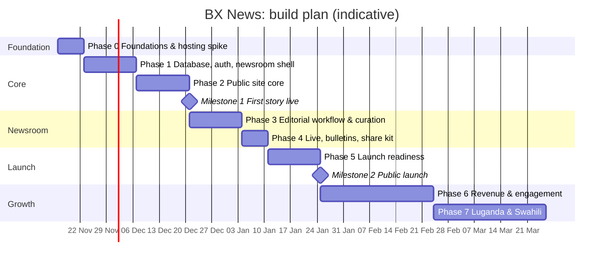

# 04 · Roadmap

> **Assumption:** about 15–20 development hours per week (one developer, with AI assistance). Durations scale with available time. Update the status column at every Sunday review.
> **Status key:** ⬜ Not started · 🟦 In progress · ✅ Done (verified) · ⛔ Blocked

---

## Overview

| Phase | Weeks | Outcome |
|-------|-------|---------|
| 0. Foundations & hosting spike | 1 | Accounts, repo, domain, hosting decision proven |
| 1. Database, auth, newsroom shell | 2–3 | Staff can log in; schema live |
| 2. Public site core | 4–5 | **Milestone 1: first story live** |
| 3. Editorial workflow & curation | 6–7 | Review flow, homepage board, breaking, media, corrections |
| 4. Live, bulletins, share kit | 8 | YouTube live/bulletins; social share kit |
| 5. Launch readiness | 9–10 | Policies, SEO, performance, security, backups. **Milestone 2: public launch** |
| 6. Revenue & engagement | 11–14 | AdSense application, direct ads, newsletter, web push |
| 7. Languages | 15+ | Luganda, then Swahili |
| 8. Later | — | Payments/memberships, live blogs, apps, comments review |

---

## Phase 0 · Foundations & hosting spike (week 1)

| # | Task | Status |
|---|------|--------|
| 0.1 | Confirm Node.js LTS, Git, VS Code installed | ✅ Node v24, Git 2.55 confirmed 15 Nov |
| 0.2 | Push this document repo to GitHub | ✅ 15 Nov |
| 0.3 | Check domain availability; buy `bemerickexpress.com` (Cloudflare Registrar) | ⬜ Postponed (D-021) |
| 0.4 | Reserve `bxnews` handles: WhatsApp Channel, TikTok, X, YouTube, Facebook, Instagram | 🟦 WhatsApp Channel created 15 Nov and linked in the footer; others pending |
| 0.5 | Create free accounts: Cloudflare, Neon, Resend, Sentry | 🟦 Cloudflare and Neon connected 15 Nov; Resend and Sentry later |
| 0.6 | Create Next.js app in `app/` with OpenNext Cloudflare | ✅ 15 Nov (Next.js 16.4; builds for Workers; brand colours and fonts applied) |
| 0.7 | **Spike:** deploy skeleton (home + article from Neon + login) to Workers free plan; record results | ✅ 15 Nov: live at `bemerick-express.bemerick-express.workers.dev`. Bundle 1.88 MB compressed (limit 3 MB); dashboard reads from Neon `main`; real sign-ins succeed, no CPU-limit errors |
| 0.8 | Record hosting decision (D-008) in Decisions Log | ✅ 15 Nov (D-024) |

**Done when:** a page that reads from Neon is live on a `workers.dev` URL, and the hosting decision is recorded.

## Phase 1 · Database, auth, newsroom shell (weeks 2–3)

| # | Task | Status |
|---|------|--------|
| 1.1 | Drizzle schema + first migration: staff_profile, section, tag, article, article_translation, article_author, article_tag, media, audit_log | ✅ 15 Nov (13 tables, migration `0000`, applied to `dev` and `main`) |
| 1.2 | Better Auth: email+password, sign-up disabled, admin plugin, roles Admin/Editor/Writer | ✅ 15 Nov |
| 1.3 | First-admin setup script | ✅ 15 Nov (`npm run create-admin` and one-time `/newsroom/setup` page) |
| 1.4 | `/newsroom` layout with server-side session + role check | ✅ 15 Nov |
| 1.5 | `can(user, permission)` helper + tests | ✅ 16 Nov (5 tests, `npm test`) |
| 1.6 | Seed sections | ✅ 15 Nov (`npm run db:seed`, on `dev` and `main`) |
| 1.7 | Brand tokens + fonts in Tailwind config | ✅ 15 Nov |

**Done when:** Admin logs in; a signed-out visitor is redirected away from `/newsroom`; a Writer cannot open staff settings.

## Phase 2 · Public site core (weeks 4–5)

| # | Task | Status |
|---|------|--------|
| 2.1 | Global layout: header, swipe strip, footer, dark mode | ✅ 15 Nov (collapsible sidebar, D-023) |
| 2.2 | Basic story editor (headline, standfirst, Tiptap body, section, lead photo upload to R2) | ✅ 16 Nov (lead photo upload, D-026; confirmed by the owner on a real story) |
| 2.3 | Publish / unpublish (admin) | ✅ 15 Nov |
| 2.4 | Article page (byline, times, photo + credit, body, related) | ✅ 16 Nov (photo + caption + credit, also on homepage, section lists and link previews; "More from <section>" related stories) |
| 2.5 | Homepage (latest-based) + section pages | ✅ 15 Nov |
| 2.6 | Caching + on-publish revalidation | ✅ 18 Nov: Vercel Runtime Cache, cleared on every newsroom change (D-039) |
| 2.7 | Favicon, manifest, page titles `Headline · BEMERICK EXPRESS` | ✅ 16 Nov (web app manifest, home-screen and Apple icons) |

### 🏁 Milestone 1 · First story live: ✅ reached 16 Nov 2026
Admin signs in → writes a story with a photo → publishes → it appears on the homepage, its section page and its own URL → a signed-out visitor reads it on a phone → drafts are not reachable by URL.

## Phase 3 · Editorial workflow & curation (weeks 6–7)

Review states and transitions (Architecture §6) · review queue · editorial notes · scheduling (cron) · revision history · corrections · legal hold + pre-publish checklist · **homepage board (Lead + Top Stories)** · breaking banner control · media library with required credit/alt · staff invites · author pages · tags/topic pages · audit log viewer · 2FA for Admin/Editor.

| Done | In progress / next |
|------|--------------------|
| ✅ 16 Nov: review states and transitions (tested), review queue, editorial notes, scheduling (D-027), unpublish with reason, admin fast-track, staff invites (D-028), revision history, corrections (public `/corrections` page), legal hold, pre-publish checklist, homepage board (Lead + Top Stories, pin-until, homepage-only headlines), breaking banner (one at a time, auto-expiry). ✅ 17 Nov: media library (search, reuse in editor, edit credit/alt, safe delete; D-029), author pages and staff profiles (opt-in; D-030), tags and topic pages (D-031), audit log viewer "History" (D-032), two-step sign-in for Admins/Editors (D-033). **Phase 3 complete** | (none) |

**Done when:** Writer submits → Editor requests changes → Writer resubmits → Editor approves and schedules → story auto-publishes → Editor places it as Lead → breaking banner shows and auto-expires. *(Verified 16 Nov in browser tests: every step through "breaking banner shows". Expiry is checked by the banner query and unit-tested board rules.)*

## Phase 4 · Live, bulletins, share kit (week 8)

`/live` page + site-wide LIVE pill · `/bulletins` page (YouTube, click-to-load) · auto-generated share images (1200×630, 1080×1080, 1080×1920) · share kit with WhatsApp/X/TikTok text · WhatsApp Channel follow prompts.

| Done | In progress / next |
|------|--------------------|
| ✅ 17 Nov: `/live` page, site-wide LIVE pill, newsroom live controls, video bulletins and `/bulletins`, click-to-load YouTube player (D-034); share images in three sizes, newsroom share kit, reader share buttons and WhatsApp Channel follow box (D-036). Hosting now Vercel-only (D-035). **Phase 4 complete** | (none) |

## Phase 5 · Launch readiness (weeks 9–10)

| Area | Tasks |
|------|-------|
| Content | 30+ stories published before announcement; About, Team, Contact, Tip, Advertise pages (Team page live 16 Nov with the technology team; journalists to add) |
| Policies | Editorial, Corrections, Privacy, Terms, Cookies, reviewed by a media lawyer if possible |
| SEO | Sitemaps, Google News sitemap, RSS, structured data, Search Console, Bing, Google News Publisher Center |
| Performance | Meet budgets (Architecture §4) on a real mid-range Android over 4G |
| Accessibility | Contrast, keyboard, alt text, reduced motion |
| Security | Role tests with 4 account types + signed-out; secrets audit; WAF/rate limits |
| Ops | Nightly backup + **tested restore**, Sentry, uptime monitor, incident contact list |
| Domain | Custom domain live, `www` redirect, email routing (`news@`, `tips@`, `ads@`) |

| Done | In progress / next |
|------|--------------------|
| ✅ 18 Nov: SEO groundwork: sitemaps, Google News sitemap, RSS, structured data, indexing launch switch (D-037); About, Contact, news tip, Advertise, Latest, Search, draft policies and the newsroom Inbox (D-038); Lighthouse audit, layout-shift fix and caching (D-039); functions moved to Frankfurt and photos served from Vercel's edge (D-040): story LCP 4.3–4.8 s → 3.0–3.6 s on Lighthouse's slow-4G phone test. ✅ 20 Nov: nightly encrypted backups with a restore check, error reporting ready for Sentry (D-041), sign-in hardening, secrets audit and role tests (D-042) | Owner tasks: R2 backup key, Sentry sign-up, domain, 30+ stories, lawyer review, Search Console |

### 🚀 Milestone 2 · Public launch
Announce on WhatsApp Channel, TikTok and X.

## Phase 6 · Revenue & engagement (weeks 11–14)

Consent banner → AdSense application · direct ad slots + `/advertise` rate card · newsletter (double opt-in, morning briefing) · web push for breaking (opt-in) · most-read widget · Data Protection Office registration before collecting subscriber data.

## Phase 7 · Languages (week 15+)

Translation workflow in newsroom → `/lg` routes → Luganda launch with human-reviewed translations → Swahili.

---

## Risks

| Risk | Likelihood | Impact | Mitigation |
|------|-----------|--------|------------|
| App bundle exceeds the Workers free 3 MB limit (2.14 MB on 15 Nov, growing with each feature) | **High** | Medium | Track size at every deploy; trim dependencies; fallback Workers Paid (~$5/mo) |
| Free-tier limits change | Medium | Medium | Verify limits; cost path ready (Architecture §11) |
| Single developer / limited hours | High | High | Strict scope; Milestone 1 before anything else |
| Not enough content at launch | Medium | High | Start writing in Phase 3; 30-story buffer |
| Defamation / legal complaint | Low–Med | High | Checklist, legal hold, corrections, revision history |
| Account takeover of staff login | Low | High | 2FA, rate limits, audit log, no public sign-up |
| Data loss | Low | High | Nightly backups + monthly restore test |
| Name/domain taken | Low | High | Check and buy domain in Phase 0 |

---

## Weekly review (Sundays, 7:30 PM EAT)

Each review: (1) what was completed (verified, not assumed); (2) what's in progress; (3) blockers; (4) decisions needed → Decisions Log; (5) next 1–3 actions. Update the status columns above.
